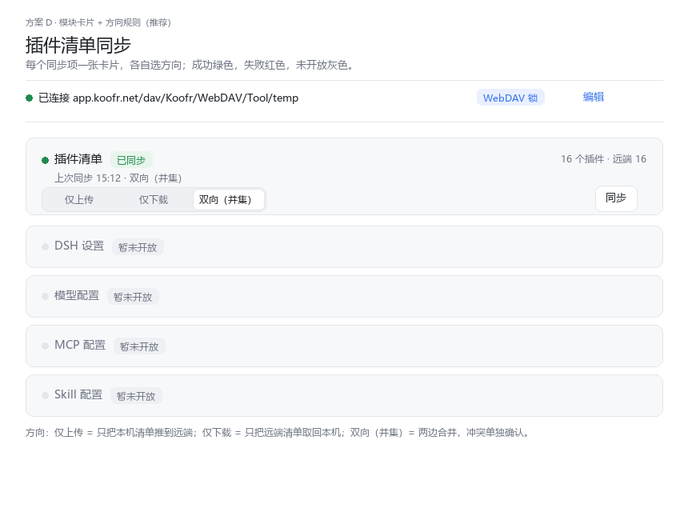
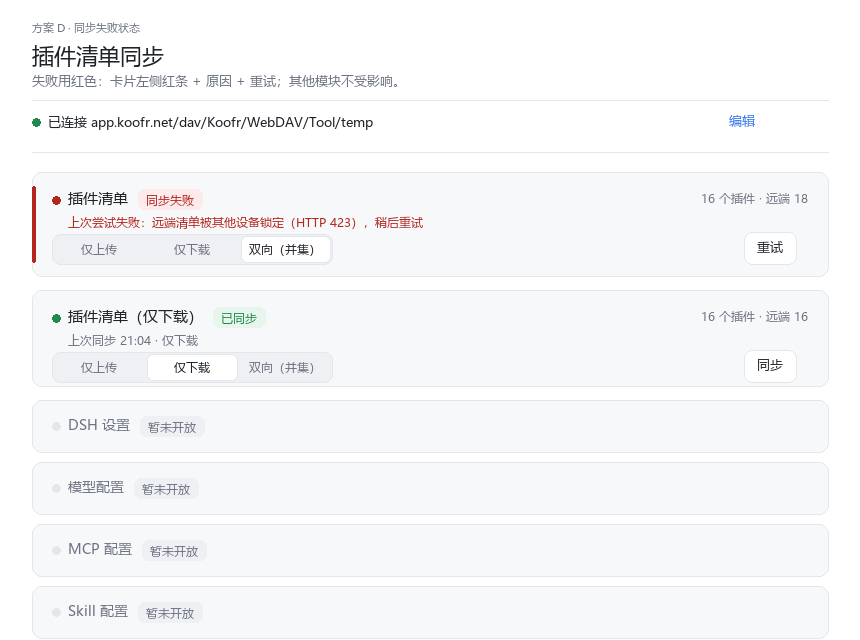
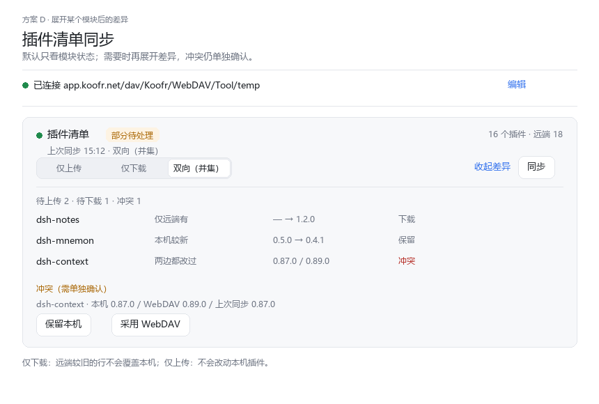
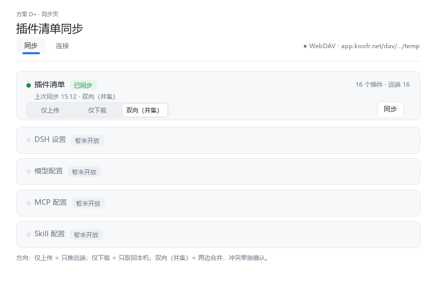
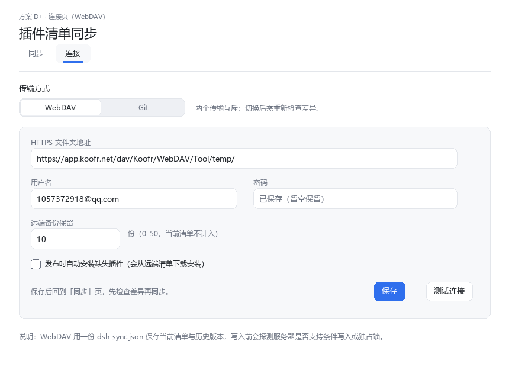
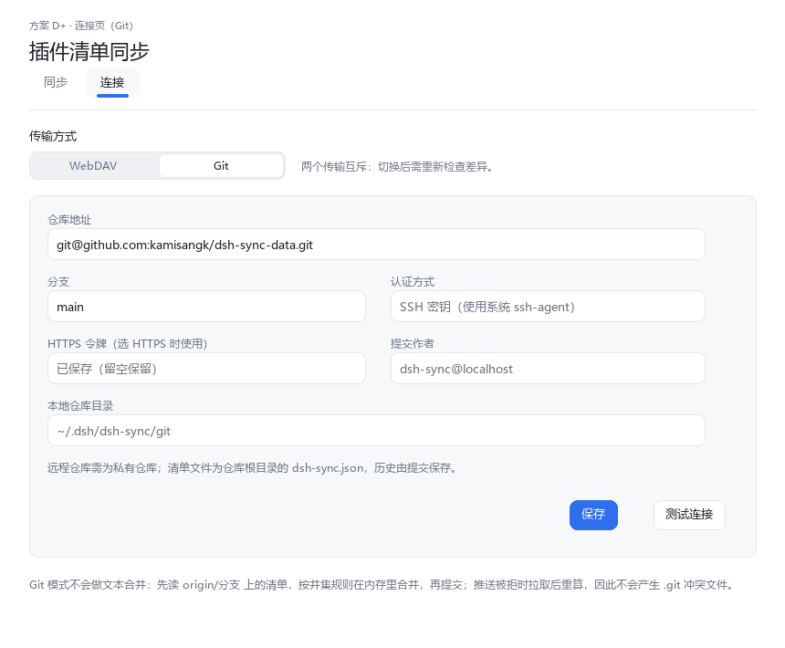
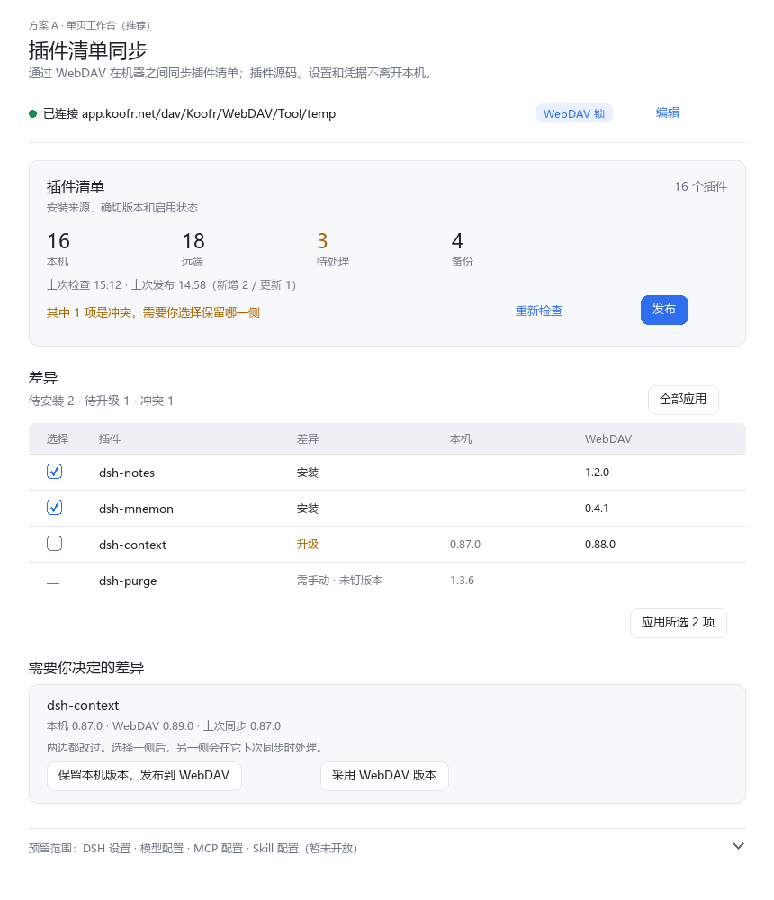
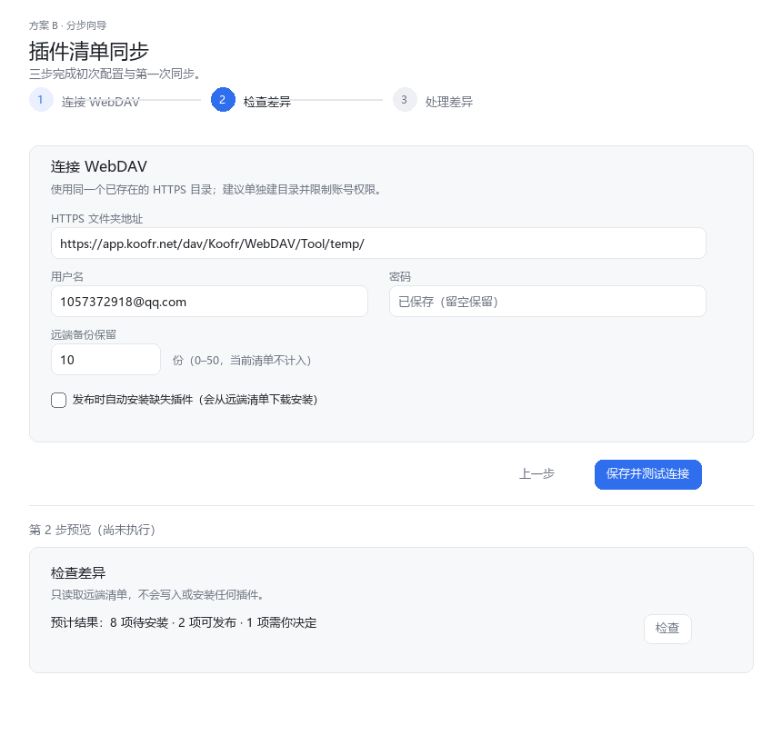
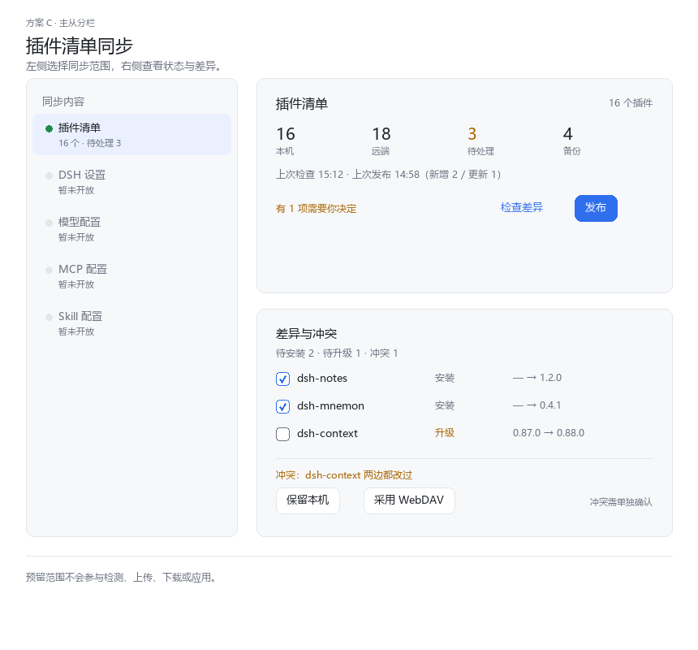

# 设置页视觉样例

> 设计样例图，不是插件运行截图。生成脚本：`scripts/render-mockups.py`（`python scripts/render-mockups.py` 重出全部图片）。
> 完整规范见 [UI-DESIGN.md](UI-DESIGN.md)。

---

## 方案 D · 模块卡片 + 方向规则（最新推荐）

每个同步项 = 一张小卡片；卡片上只放：**状态点、名称、状态徽标、上次同步时间、方向选择、同步/重试按钮**。成功绿色、失败红色、未开放灰色。

### 正常状态

- 插件清单：`● 已同步`，方向 `双向（并集）`，右侧 `同步`。
- DSH 设置 / 模型配置 / MCP 配置 / Skill 配置：灰色 `暂未开放`，不显示方向与按钮。

### 失败状态

- 卡片左侧红条 + `同步失败` 徽标 + 一行具体原因（例：`远端清单被其他设备锁定（HTTP 423），稍后重试`）+ `重试`。
- 失败只影响该模块，其他模块保持各自状态。

### 展开差异（需要时）

默认只看模块状态；点「显示差异」才在卡片内部展开，冲突仍在展开区内单独确认。

### 三种方向的语义（对插件清单）

| 方向 | 读远端 | 写远端 | 改本机 | 说明 |
|---|---|---|---|---|
| **仅上传** | 否 | 是 | 否 | 把本机可移植插件清单推上去；远端已有的同名项不改 |
| **仅下载** | 是 | 否 | 是（安装缺失、可选升级） | 只把远端清单取回本机；不卸载、不降级、不换来源 |
| **双向（并集）** | 是 | 是 | 是 | 两边合并：本机独有项上行，远端独有项下行，两边都改过 → 冲突待确认 |

所有方向都遵守既有硬规则：不传播删除、不降级、不换来源、`file:`/`link:` 与未钉版本不参与、安装走 DSH 插件管理器、写远端需二次确认。

### 数据上要补的东西（实现前明确）

1. **方向是本机设置**，按 profile + WebDAV 目标保存，不同步到远端（与密码同样只在本机）。默认 `双向（并集）`。
2. **每模块最近一次结果**（成功/失败/原因/时间）要持久化，才能画出绿/红；当前只存了 `lastSync/lastApply` 汇总。
3. `仅下载` 需要一个只读远端、只做本地应用的入口（现有 `preview` + `apply` 已具备，缺的是"一次跑完"的组合动作）。
4. `仅上传` 等价于现有 `sync` 去掉自动应用。

### 为什么这个方案比 A/B/C 更合适

- 用户已经明确要"一个模块一张卡 + 绿/红 + 方向"，这正是它的形态。
- 现在只有插件清单可用，其他四项灰色占位不抢注意力；将来接设置/模型/MCP/Skill 时，每项只是把"暂未开放"换成真实状态与方向，结构不用改。
- 信息量最小：没有指标行、没有独立差异区、没有多页签。

---

## 方案 D+ · 两页：同步 / 连接（WebDAV 或 Git）

连接配置独立成页，两页用顶部标签切换；传输方式二选一。

### 同步页

右上角一行摘要显示当前传输与目标（`● WebDAV · host/…/dir`），点「连接」进配置页。

### 连接页 · WebDAV

地址、用户名、密码、备份保留、自动安装、保存 / 测试连接。

### 连接页 · Git

仓库地址、分支、认证方式（SSH 代理或 HTTPS 令牌）、提交作者、本地仓库目录、保存 / 测试连接。

### 两种传输的差异

| | WebDAV | Git |
|---|---|---|
| 远端形态 | 一个目录里的 `dsh-sync.json` | 私有仓库根目录的 `dsh-sync.json` |
| 历史 | 文档内归档，保留 0–50 份 | 由提交保存（保留份数对该模式隐藏） |
| 并发写法 | 探测强 ETag 条件写入或独占锁，两者不可靠则拒绝 | 读 `origin/<分支>` → 内存合并 → 提交 → 推送；被拒则拉取后重算 |
| 认证 | Basic（用户名 + 密码，进凭据库） | HTTPS 令牌（askpass 注入，不进 argv/配置）或系统 ssh-agent |
| 测试连接 | 探测条件写入/锁能力 | `git ls-remote` 验证连通与权限 |
| 冲突文件 | 不产生 | **不产生**：语义合并，不做文本 merge |
| 额外要求 | 服务器支持条件写入或 LOCK | 机器上可用的 `git`；私有仓库 |

### Git 模式为什么不会产生 .git 冲突

我们从不把两边的 JSON 交给 Git 做文本合并：读取远端版本靠 `git show origin/<branch>:dsh-sync.json`，与本地清单一并交给现有的 `planReconciliation` 在内存里合并，写出完整文档后再 `commit` / `push`。推送被拒（别人先推了）就 `fetch` 后重算，最多重试 3 次。这样既保留了 Git 的历史与可审计性，又沿用同一套并集/冲突规则。

### 实现影响

1. **传输抽象**：把现在写死在 `lib/core.js` 的 WebDAV 调用抽成 `Transport`（`test / readManifest / writeManifest(transform)`），Git 实现新增约 250–350 行 + 测试。
2. **连接页**：两页标签 + 传输选择 + 两套表单；切换传输时清空状态与方向缓存，并提示重新检查。
3. **每模块方向与最近结果**要持久化（本机），卡片才有绿/红与方向记忆。
4. 保留份数只在 WebDAV 模式出现；Git 模式隐藏该项。

---

# 备选方案（此前版本，供对照）

## 方案 A · 单页工作台

连接条 + 插件清单区（4 指标）+ 差异表 + 冲突区 + 预留范围。信息最全，但指标与差异区对"只想同步一下"的人偏重。

## 方案 B · 分步向导

连接 → 检查 → 处理三步。适合首次接入引导，不适合日常反复同步。

## 方案 C · 主从分栏

左侧范围列表 + 右侧详情。四个范围都落地后最自然，现在左栏会有 4 项空位。

---

## 对比

| 维度 | D 模块卡片 | A 单页工作台 | B 向导 | C 主从 |
|---|---|---|---|---|
| 与用户预期的贴合 | **高** | 中 | 中 | 中 |
| 日常同步效率 | **高** | 高 | 低 | 中 |
| 信息密度 | **低（最简）** | 高 | 中 | 中 |
| 多范围扩展 | **高** | 低 | 中 | 高 |
| 失败可见性 | **高（红卡）** | 中 | 中 | 中 |
| 实现改动面 | 中（要加方向与状态持久化） | 小 | 中 | 中 |

**结论：按方案 D 改。** 先做三件事：模块卡骨架（含灰/绿/红三态）→ 方向选择与本机持久化 → `仅下载`/`仅上传`/`双向` 三条执行路径复用现有 engine。